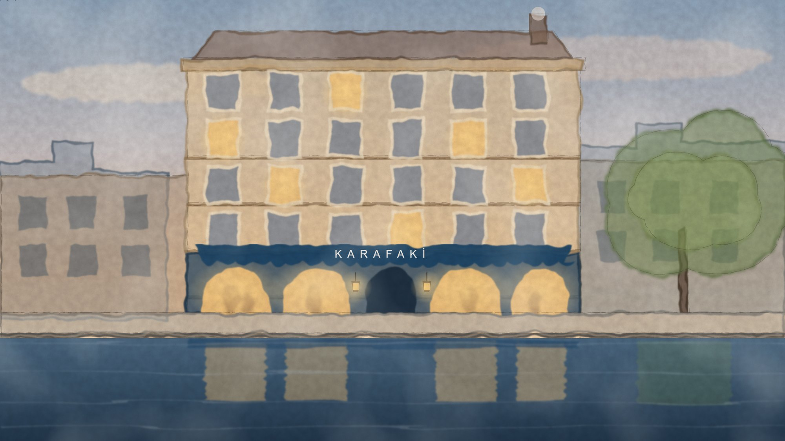

# Design Portfolio

**Gallery:** https://erhanerogluant.github.io/design-portfolio/

Brand identities, print (brochure, poster), watercolour and pen-and-ink illustrations, and restaurant website concepts.

| # | Work | What | Files |
|---|---|---|---|
| 01 | **ANT Engineering** | Logo and corporate identity (letterhead, business card, envelope, label; contact details blurred) | [01-ant-engineering](01-ant-engineering) |
| 02 | **KARAFAKİ** | Logo, wordmark, animated SVG watercolour of the canal façade, website — [live site](https://erhanerogluant.github.io/karafaki-concept/) | [02-karafaki](02-karafaki) |
| 03 | **Ink sketches** | Pen-and-ink meyhane motifs drawn as SVG (drawn stroke by stroke on the website) | [03-ink-sketches](03-ink-sketches) |
| 04 | **Maison AUREL** | Website concept for a fine-dining restaurant — [live site](https://erhanerogluant.github.io/maison-concept/) | [04-maison-aurel](04-maison-aurel) |
| 05 | **Hoftheater Kreuzberg** | Bilingual season brochure (A5, 4 pages) and A3 poster | [05-hof-theatre](05-hof-theatre) |

Vector originals (`.svg`) are included for the KARAFAKİ marks, the watercolour façade and every
ink sketch. KARAFAKİ and Maison AUREL are design concepts for fictional restaurants; the
photography on those websites is from Unsplash, Wikimedia Commons and Pexels and is credited on
each site.

## Licence

© Erhan Eroglu. All rights reserved — see [LICENSE](LICENSE). The images may be viewed here; they
may not be reused, modified or redistributed without written permission.
